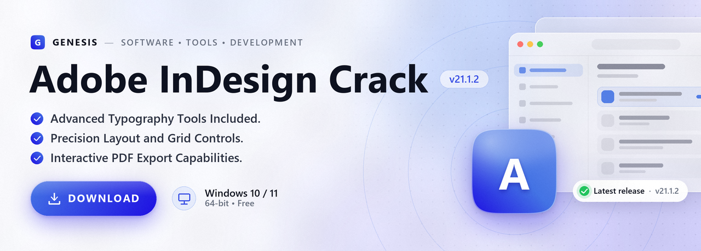

# Adobe Indesign - Windows 10 & 11

## Introduction

Adobe InDesign is a professional desktop publishing software that enables users to create stunning layouts for print and digital media. It addresses the needs of graphic designers, publishers, and marketing professionals who require powerful tools for typesetting and layout design. With InDesign, users can produce everything from brochures and magazines to interactive documents and eBooks.

This software offers an extensive array of features that facilitate precise control over typography, color, and layout. Users can expect a versatile platform that supports collaboration with other Adobe Creative Cloud applications, allowing for seamless integration of images, graphics, and videos into their designs. InDesign’s advanced publishing options enable users to efficiently manage large-scale projects, making it an essential tool for anyone in the design and publishing industries.

InDesign not only serves as a tool for creating visually appealing layouts but also provides a comprehensive environment for managing complex design workflows. Its integration with Adobe Creative Cloud enhances user experience by offering cloud storage, file sharing, and collaborative capabilities. Whether creating a simple flyer or a complex multi-page publication, InDesign provides the flexibility and power needed to bring creative visions to life.

---

## System Requirements

| Requirement            | Details                                     |
|-----------------------|---------------------------------------------|
| Supported OS          | Windows 10 (64-bit) and Windows 11 (64-bit) |
| Processor             | Intel or AMD multi-core processor with 64-bit support |
| RAM                   | Minimum 8 GB; 16 GB recommended for optimal performance |
| Storage               | 4 GB of available hard-disk space; additional space required for installation |
| Permissions           | Administrator privileges may be required for installation |
| Internet Connection    | Required for product activation and updates |
| Dependencies          | Adobe Creative Cloud account required for access to certain features |

### Detailed System Requirements

**Operating System**:  
Both Windows 10 and Windows 11 must be 64-bit to ensure compatibility with InDesign. Users running older versions of Windows or 32-bit systems will need to upgrade to meet these requirements.

**Processor**:  
A multi-core processor is crucial for handling complex documents and multitasking. A newer processor will improve performance, especially when working with high-resolution images and large files.

**RAM**:  
While InDesign can run with 8 GB of RAM, users working on extensive projects with multiple assets and applications running simultaneously should consider upgrading to 16 GB or more to avoid slowdowns.

**Storage**:  
Ensure that your hard drive has sufficient space not only for the installation of InDesign but also for temporary files created during the design process. SSDs (Solid State Drives) are preferred for faster load times and improved performance.

**Internet Connection**:  
An active internet connection is essential for initial software activation, downloading updates, and syncing files with Adobe Creative Cloud. However, once activated, InDesign can be used offline, but some features may be limited.

---

## Features

- **Comprehensive Layout Design**: InDesign provides a robust set of tools for creating multi-page documents, enabling users to maintain consistent styles and formats throughout their projects. Users can utilize master pages, grids, and guides to ensure a cohesive design.

- **Advanced Typography Control**: Users can manipulate text with precision, utilizing features such as character styles, paragraph styles, and OpenType font support to achieve professional results. This allows for fine-tuning of text attributes such as kerning, tracking, and leading.

- **Interactive Document Creation**: InDesign supports the creation of interactive PDFs and digital publications, allowing users to include hyperlinks, buttons, and multimedia elements. This is particularly useful for creating engaging content for digital distribution.

- **Collaboration Tools**: The software allows multiple users to work on projects simultaneously through Adobe Creative Cloud, streamlining the review and approval process. Team members can leave comments and annotations directly in the document, facilitating real-time feedback.

- **Integration with Other Adobe Products**: Seamlessly import assets from Adobe Photoshop, Illustrator, and other Creative Cloud applications, enhancing workflow efficiency. For example, users can create complex graphics in Illustrator and import them directly into their InDesign layout without losing quality.

- **Preflight and Print Production**: Built-in preflight tools help identify potential issues before printing, ensuring that designs meet industry standards and are error-free. Users can set up custom preflight profiles tailored to their project's requirements.

- **Customizable Workspace**: Users can tailor the InDesign interface to their preferences, enabling quick access to frequently used tools and panels. This customization can greatly enhance productivity, especially for users who work on different types of projects.

- **Support for Multiple Formats**: InDesign allows for the export of documents in various formats, including PDF, EPUB, and HTML, catering to different publishing needs. Users can also publish directly to digital platforms or create print-ready files with ease.

- **Data Merge Functionality**: Users can automate the process of creating personalized documents, such as invitations or labels, by merging data from spreadsheets into templates. This feature is particularly useful for marketing materials that require customization at scale.

- **Robust Styles and Formatting Options**: InDesign offers extensive style management, enabling users to create and apply custom styles to maintain brand consistency across documents. Users can create style groups to organize and apply formatting quickly.

---

## How It Works

1. **Create a New Document**: Begin by selecting a new document template or customizing your own layout, setting the page size, margins, and columns according to your project requirements. For instance, when designing a magazine, you may opt for a standard letter size with specific margins for bleed and gutter.

2. **Design Your Layout**: Use the powerful tools to add text, images, and graphics to your layout. Utilize grids and guides for precise placement and alignment of elements. The alignment tools can help maintain visual harmony across the entire document.

3. **Incorporate Interactive Elements**: If desired, add buttons, hyperlinks, and multimedia content to enhance interactivity, particularly for digital publications. For example, you can create a button that links to an external website or an embedded video that plays within the document.

4. **Export and Share**: Once your design is complete, export your document in the desired format, ensuring compatibility with print or digital platforms as needed. Choose options like PDF/X for high-quality print production, or EPUB for eBook distribution.

5. **Review and Revise**: Utilize the collaboration tools to share your document with team members or clients for feedback. Make necessary revisions based on comments and prepare the final version for distribution.

---

## Compatibility

**Operating Systems and Architecture**  
Adobe InDesign is compatible with Windows 10 and Windows 11, specifically designed for 64-bit systems. Ensure that your operating system is fully updated to avoid compatibility issues.

**Hardware Requirements**  
The software requires a multi-core processor and is optimized for at least 8 GB of RAM, with 16 GB recommended for handling larger projects effectively. Users with older or less powerful hardware may experience lag during intensive tasks.

**Runtime Dependencies**  
An Adobe Creative Cloud account is necessary to access certain features and updates. This account provides cloud storage and collaboration capabilities, enhancing your overall workflow. Users should ensure they have a stable internet connection for ongoing access.

**Limitations and Notes**  
While InDesign supports various file formats, the performance may vary depending on the complexity of the documents and system specifications. For maximum efficiency, it is recommended to close unnecessary applications and free up system resources while working in InDesign.

---

## FAQ

### What is Adobe InDesign used for?
Adobe InDesign is primarily used for creating layouts for print and digital publications. It is favored by graphic designers, publishers, and marketers for its extensive design capabilities and versatility in managing complex documents.

### How do I install Adobe InDesign on my Windows computer?
To install Adobe InDesign, download it from the Adobe Creative Cloud website. Run the installer and follow the on-screen instructions. Ensure you have administrator privileges for installation, and an active internet connection for product activation.

### Is Adobe InDesign compatible with Windows 10 and Windows 11?
Yes, Adobe InDesign is compatible with both Windows 10 and Windows 11, specifically designed for 64-bit architecture. Ensure your system meets the specified requirements for optimal performance.

### Can I use Adobe InDesign without an internet connection?
While installation requires an internet connection for activation, Adobe InDesign can be used offline afterward. However, certain features, including updates and collaboration tools, may require internet access.

### What should I do if I encounter issues while using Adobe InDesign?
If you experience issues, check the Adobe support website for troubleshooting guides. Common solutions include updating the software, checking for conflicting applications, or ensuring that your system meets the required specifications. If problems persist, consider reaching out to Adobe's customer support for assistance.

---

## Disclaimer

Details regarding Adobe InDesign may vary based on the version and specific system configurations. It is recommended that users back up important data before making any significant changes or installations. Always refer to the official Adobe website for the most current information and support resources.

---

## License

The licensing information for Adobe InDesign can vary. Users should consult the license distributed with the software or refer to Adobe's official terms for clarification on usage rights and restrictions. Generally, Adobe offers various licensing options, including subscriptions for individuals, teams, and enterprises. It's essential to understand the terms of use to ensure compliance with Adobe's policies. 

Adobe InDesign is a powerful tool designed to meet the needs of professional publishers and designers, and understanding its licensing and usage rights is crucial for maximizing its potential in your creative projects.
